# Exercise 2 – Solution

Gali Mustapha Oluwatoyin (galimo201516-web)

I ran everything on Windows with Ubuntu 24.04 (WSL2), Docker Engine and the `postgres:18.1` container `pg-bigdata`. The data was generated with the given Python scripts. They use a fixed seed, so the numbers should be the same on other machines. Screenshots of my runs are in the `screenshots` folder.

## Part 0 and Part 1

The container started fine and `people_big` was loaded with 1,000,000 rows.

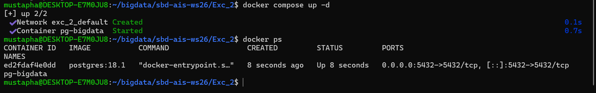

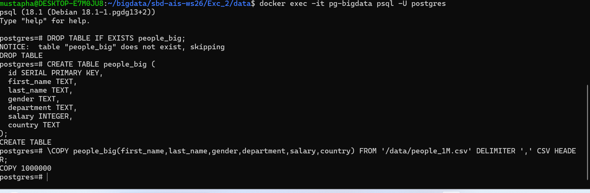

Example queries:

| Query | Time |
|---|---|
| COUNT(*) | 565 ms |
| SELECT * LIMIT 10 | 3 ms |
| (a) average salary per department, LIMIT 10 | 2,058 ms |
| (b) nested aggregation, LIMIT 10 | 3,016 ms |
| (c) top 10 salaries | 568 ms |

**Does LIMIT 10 make (a) and (b) cheaper?** No. I ran EXPLAIN ANALYZE on (a) with and without LIMIT. In both plans the Parallel Seq Scan reads all 1,000,000 rows (333,333 rows × 3 processes) and all 85 department groups are built. LIMIT only cuts the output at the very end. This makes sense, because the average of a group is only known after the last row is read, so the database can't stop early.

The times jumped around between runs: with LIMIT 2.0–3.1 s, without LIMIT 1.3–1.8 s (the screenshot shows the 1.75 s run). So the difference is just noise, not LIMIT. Query (c) is different: there PostgreSQL only keeps the best 10 rows while scanning (top-N sort), so LIMIT does help.

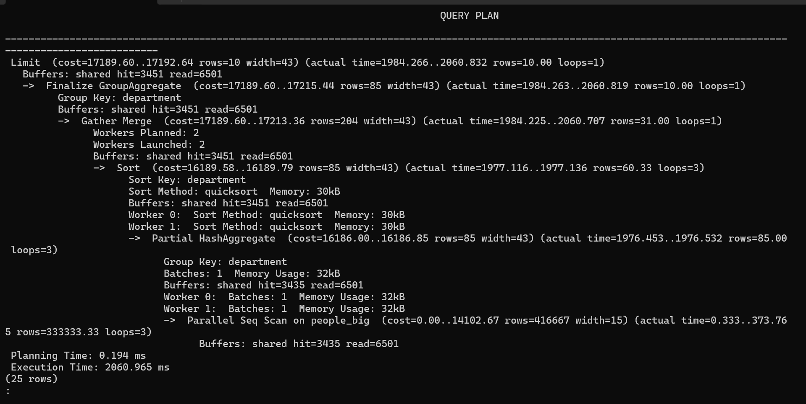

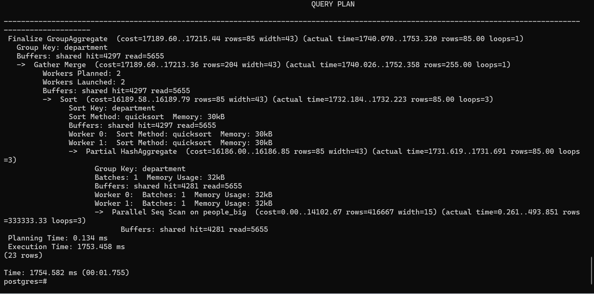

## Activity 2.1

### Table

```sql
CREATE TABLE orders (
  id SERIAL PRIMARY KEY,
  customer_name TEXT,
  product_category TEXT,
  quantity INTEGER,
  price_per_unit NUMERIC(10,2),
  order_date DATE,
  country TEXT
);

\COPY orders(customer_name,product_category,quantity,price_per_unit,order_date,country) FROM '/data/orders_1M.csv' DELIMITER ',' CSV HEADER;
```

Result: `COPY 1000000`.

My reasons for these types:
- I added `id` because the CSV has no order number, and question A asks *which order*.
- I used `NUMERIC(10,2)` for the price because money should be exact. FLOAT can give rounding errors.
- `order_date` is a `DATE` so it is stored as a real date and not as text.

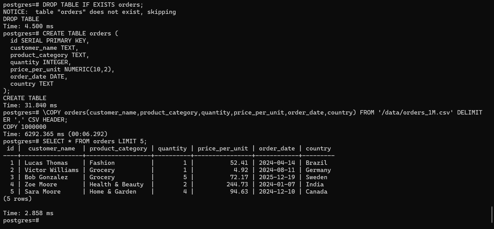

### A. Highest price_per_unit

```sql
SELECT *
FROM orders
WHERE price_per_unit = (SELECT MAX(price_per_unit) FROM orders);
```

Result: order **841292**, Emma Brown, Automotive, quantity 3, **2000.00**, 2024-10-11, Italy.

I used MAX instead of `ORDER BY ... LIMIT 1` so that I would see it if several orders had the same top price. Only one row came back, so there is no tie.

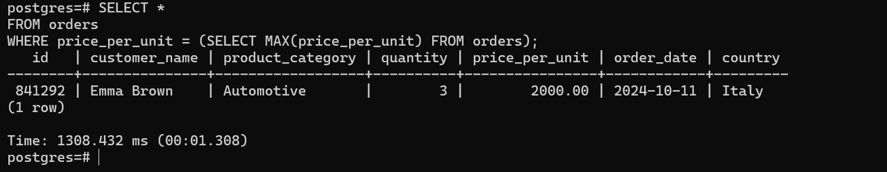

### B. Top 3 categories by quantity

```sql
SELECT product_category, SUM(quantity) AS total_quantity
FROM orders
GROUP BY product_category
ORDER BY total_quantity DESC
LIMIT 3;
```

| Category | Total quantity |
|---|---|
| Health & Beauty | 300,842 |
| Electronics | 300,804 |
| Toys | 300,598 |

The three are almost the same (only 244 units apart). The generator picks the category and the quantity randomly, so every category should end up around 300,000. The ranking is basically random.

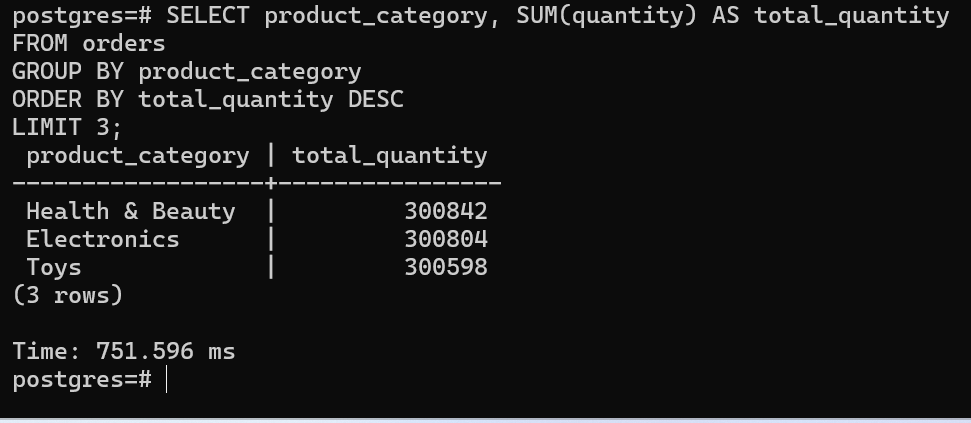

### C. Revenue per category

```sql
SELECT product_category,
       SUM(price_per_unit * quantity) AS total_revenue
FROM orders
GROUP BY product_category
ORDER BY total_revenue DESC;
```

| Category | Revenue |
|---|---|
| Automotive | 306,589,798.86 |
| Electronics | 241,525,009.45 |
| Home & Garden | 78,023,780.09 |
| Sports | 61,848,990.83 |
| Health & Beauty | 46,599,817.89 |
| Office Supplies | 38,276,061.64 |
| Fashion | 31,566,368.22 |
| Toys | 23,271,039.02 |
| Grocery | 15,268,355.66 |
| Books | 12,731,976.04 |

Here the order is not random. It follows the price ranges in the generator: Automotive goes up to 2,000 per unit and Books only up to 80.

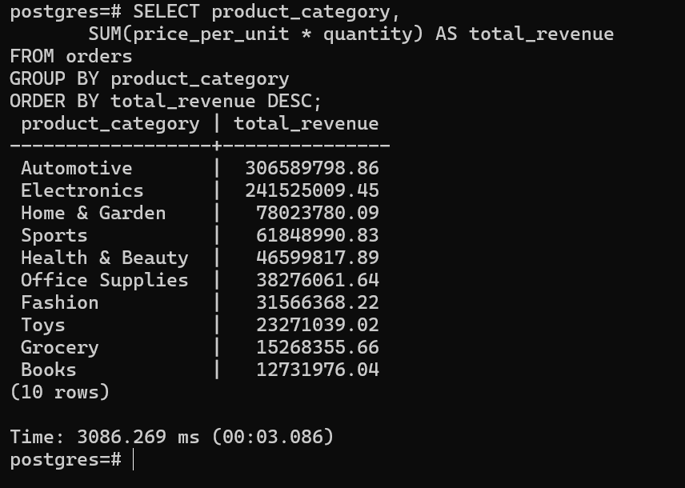

### D. Top 5 customers

```sql
SELECT customer_name,
       SUM(price_per_unit * quantity) AS total_spent,
       COUNT(*) AS num_orders
FROM orders
GROUP BY customer_name
ORDER BY total_spent DESC
LIMIT 5;
```

| Customer | Total spent | Orders |
|---|---|---|
| Carol Taylor | 991,179.18 | 1,028 |
| Nina Lopez | 975,444.95 | 980 |
| Daniel Jackson | 959,344.48 | 1,033 |
| Carol Lewis | 947,708.57 | 943 |
| Daniel Young | 946,030.14 | 973 |

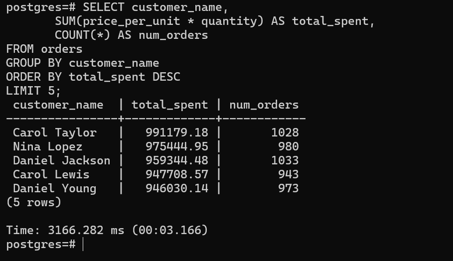

### E. What I noticed

Every top customer has around 1,000 orders and almost the same total. That is not realistic: no real customer orders more than once a day for two years, and real spending is much more uneven.

To check this, I counted the orders for every name:

```sql
SELECT COUNT(*) AS distinct_names, MIN(n), ROUND(AVG(n)), MAX(n)
FROM (SELECT customer_name, COUNT(*) AS n
      FROM orders GROUP BY customer_name) per_name;
```

Result: **1056** names, between 837 and 1043 orders each, average 947.

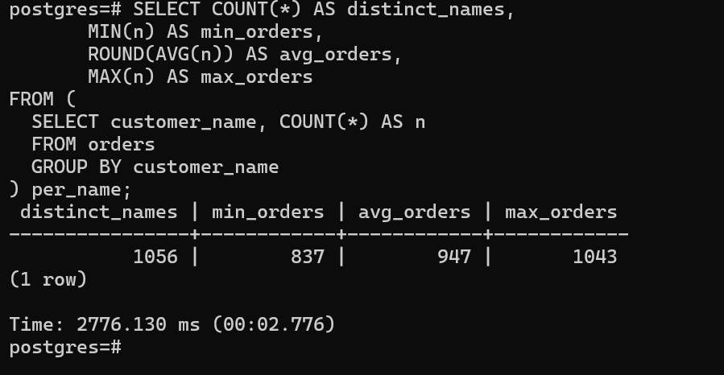

The reason is in `dataset_generator.py`. There is no customer ID. Each order gets a random first name (32 options) and a random last name (33 options). That is only 32 × 33 = 1056 possible names for 1 million orders, so each "customer" is really about 947 orders from different people who share a name. Because everything else is random too, all these groups end up with similar totals. So `customer_name` can't be used to identify customers. A real system would need a `customer_id`.

## Activity 2.2

### Step 1

```sql
CREATE TABLE people_50k  AS SELECT * FROM people_big WHERE id <= 50000;
CREATE TABLE people_100k AS SELECT * FROM people_big WHERE id <= 100000;
CREATE TABLE people_200k AS SELECT * FROM people_big WHERE id <= 200000;
```

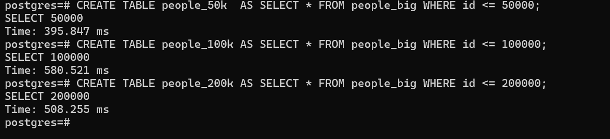

| Rows | COUNT(*) | Time |
|---|---|---|
| 50,000 | 27,501,822 | 4.6 s |
| 100,000 | 109,946,508 | 51.4 s |
| 200,000 | 439,395,606 | 101.9 s |

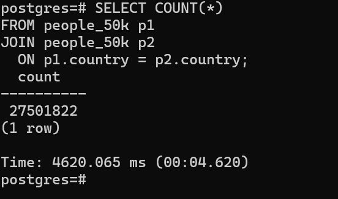

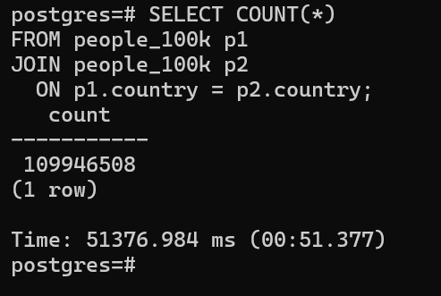

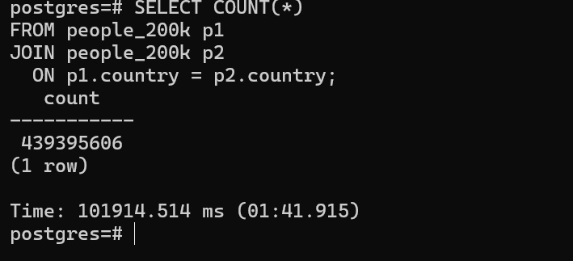

When the input doubles, the result grows **4 times** both times. The reason: if a country has k people, it gives k × k pairs. So doubling the people doubles k, which makes k × k four times bigger.

The time was less stable (×11, then ×2). My later runs of the 100k query took 30–36 s, so the 51 s run was probably slow for other reasons. From 50k to 200k the time grew about 22 times, which is around 4–5 times per doubling.

**My prediction for 1M rows** (5 times 200k, so 5 × 5 = 25 times more):
- result ≈ 439 million × 25 ≈ **11 billion**
- time ≈ 102 s × 25 ≈ **42 minutes**

### Step 2

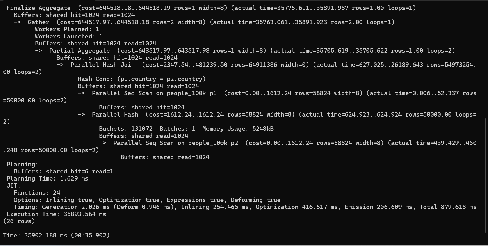

```sql
CREATE INDEX idx_people_100k_country ON people_100k(country);
ANALYZE people_100k;
```

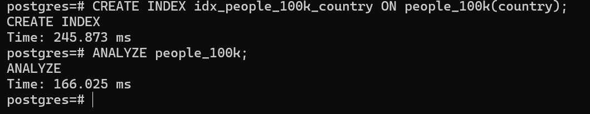

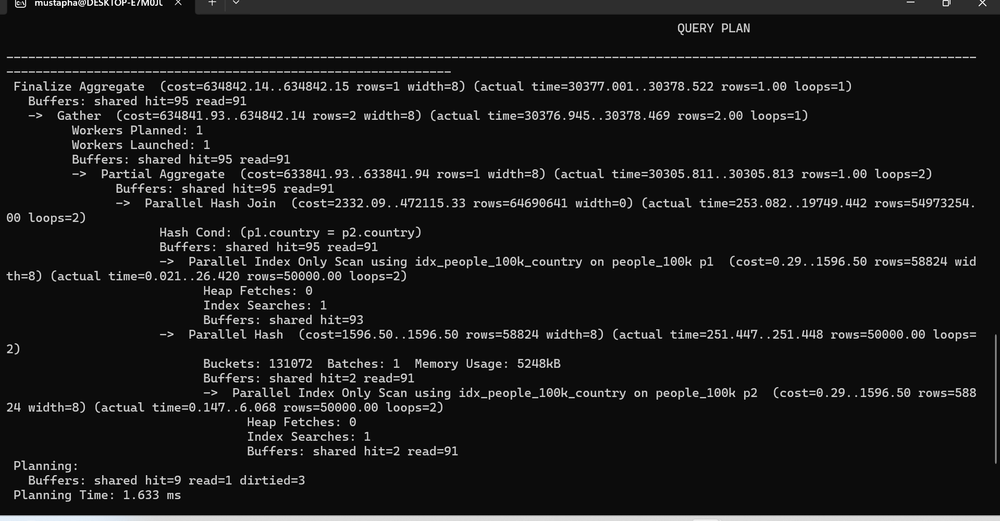

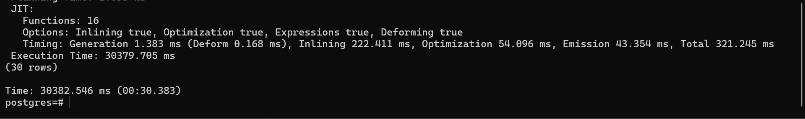

Without the index the query took 35.9 s; with the index it took 30.4 s. PostgreSQL did use the index (Index Only Scan instead of Seq Scan), but it is still a Hash Join and it still produces the same 109,946,508 pairs.

The plan shows why the index doesn't help much. Reading the rows took less than a second even without the index. Almost all the time is spent creating and counting the 110 million pairs, and an index can't reduce how many pairs there are. Indexes are useful when you need a few rows (like `WHERE country = 'Austria'`), not here. The 5 s difference is about the same as the normal variation between my runs.

### Step 3

A country with k people gives k × k pairs, so I can just count people per country and add up the squares:

```sql
SELECT SUM(cnt * cnt) AS pairs
FROM (
  SELECT country, COUNT(*) AS cnt
  FROM people_100k
  GROUP BY country
) per_country;
```

- people_100k: **109,946,508** in **20.6 ms**. That is the same number as the join, which took 30–50 seconds.
- people_big: **10,983,941,260** in **1.75 s**. That matches my prediction of about 11 billion, and it is much faster than the predicted 42 minutes.

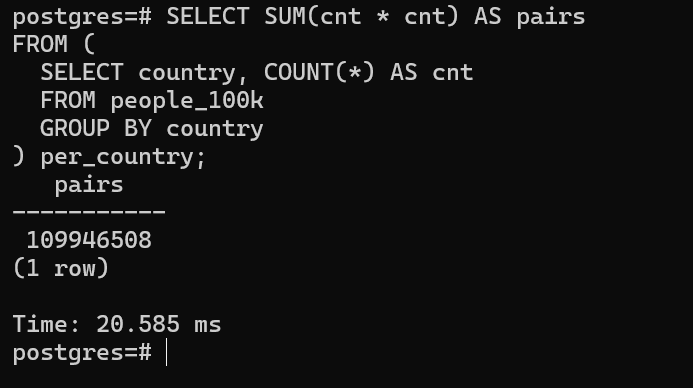

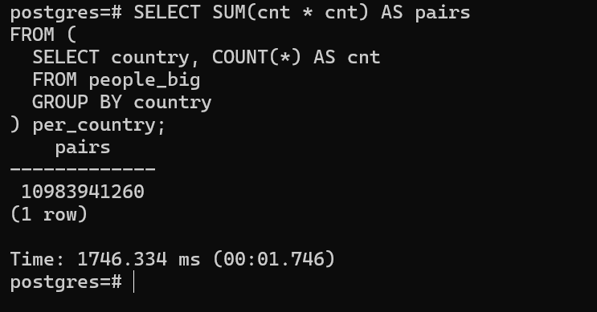

### Step 4 – Discussion

**Hardware and indexes.** The rewrite was about 1,400 times faster on the same laptop, while the index changed almost nothing. The problem is the query itself, because the join has to build n² pairs. A faster machine with 8 times more cores would make the join maybe 8 times faster, but it would still grow with n². With 10 times more data, the join does 100 times more work and the rewrite only 10 times more. So the first thing to fix is the query, not the hardware.

**If the business really needs the pairs.** Then there is no shortcut, because the output itself is about 11 billion rows. Even with only two IDs per pair that is around 88 GB. A bigger machine helps a bit, but there is a limit to how big one machine can get, and it gets expensive quickly.

A cluster would help more, because pairs only exist inside one country. If the data is partitioned by country (for example in Spark), each node can build the pairs for its own countries without talking to the others. This should scale almost linearly. There are some limits, though:
- There are only about 92 countries, so you can't use more than about 92 partitions unless you split big countries.
- Some partitions are bigger than others. Chile appears twice in the generator's list, so it has about 2 times the people and 4 times the pairs. The slowest partition decides the total time.
- A cluster adds network and coordination costs.

Before building all of this, I would ask whether the pairs are really needed, or whether a count or an aggregate is enough.

**Limits of an OLTP database.** PostgreSQL is made for many small transactions that touch a few rows, not for scanning and joining whole tables.
- It stores data row by row, so it reads whole rows even if only `country` is needed. A column store would only read that column.
- It runs on one machine. Read replicas let more queries run at the same time, but they don't make one big query faster.
- A 40-minute query also slows down everyone else using the database.
- In the cloud, bigger database instances get very expensive and there is a maximum size.

In a real system, I would keep PostgreSQL for the transactions and send the data out with CDC (Debezium + Kafka) to an analytical system, like a lakehouse or data warehouse (Parquet/Iceberg with Spark, or BigQuery/Redshift), or a real-time OLAP store like Apache Pinot. A stream processor could even keep a running count per country, so the answer would always be ready without touching the OLTP database.

## Clean up

```bash
docker compose down
```
