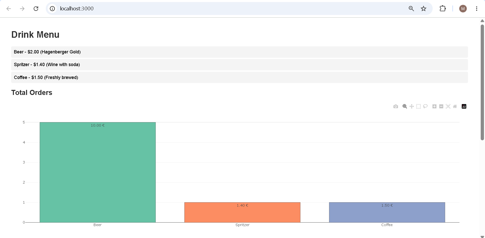
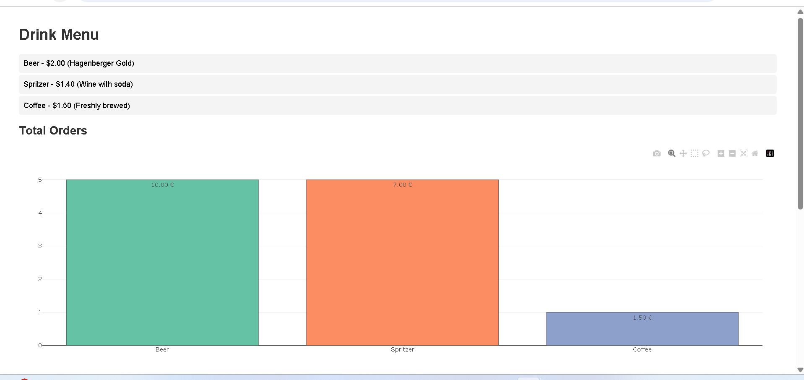
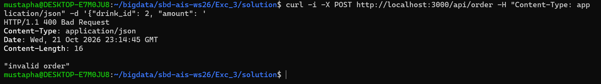
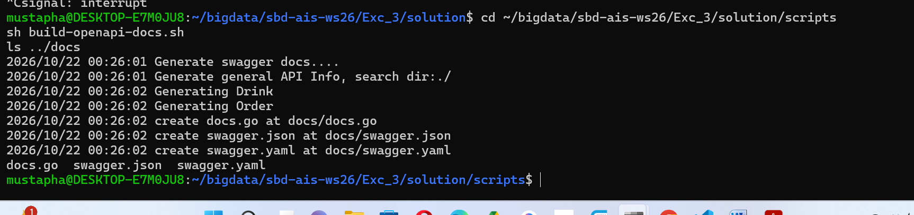
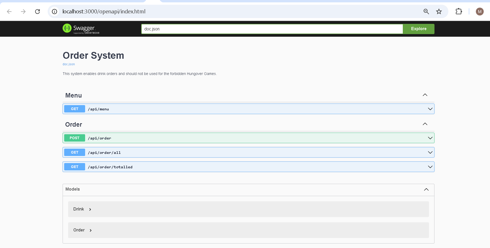
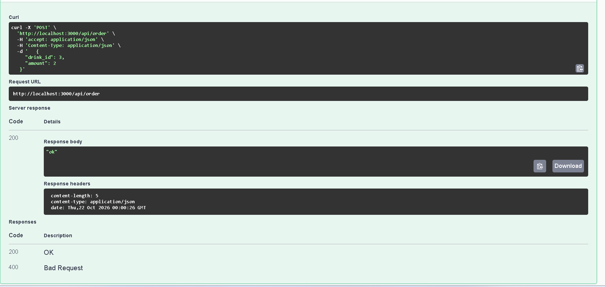
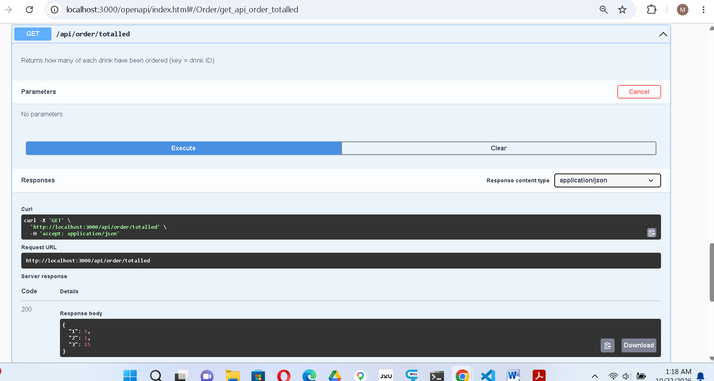
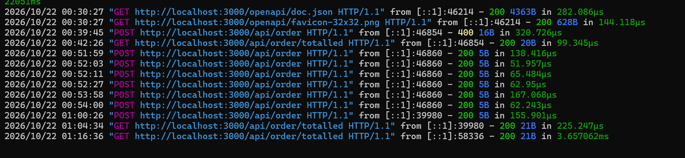

# Exercise 3 – Solution

Gali Mustapha Oluwatoyin (galimo201516-web)

In this exercise I completed a small REST web service in Go with the Chi router. It keeps drinks and orders in memory and runs on port 3000. I started from the lecturer's `skeleton/` folder, copied it to `solution/`, and answered every comment marked `todo`. I kept the lecturer's hint comments and wrote my code under them.

## How to run it

```bash
cd Exc_3/solution
go run .
```

- Dashboard: http://localhost:3000/
- Swagger (OpenAPI): http://localhost:3000/openapi/index.html

To build the OpenAPI docs again after changing the handlers:

```bash
cd scripts
sh build-openapi-docs.sh
```

## What I changed

### Models (`model/drink.go`, `model/order.go`)

I added the missing fields with snake_case JSON names, as the todo asked:

```go
type Drink struct {
	ID          uint64  `json:"id"`
	Name        string  `json:"name"`
	Price       float64 `json:"price"`
	Description string  `json:"description"`
}

type Order struct {
	DrinkID   uint64    `json:"drink_id"` // foreign key
	CreatedAt time.Time `json:"created_at"`
	Amount    uint64    `json:"amount"`
}
```

`Price` is a `float64` because the README says `number` and the dashboard formats it with two decimals. `CreatedAt` is a `time.Time`, as the todo says, so `order.go` imports the `time` package. In JSON Go writes it as a date string like `2026-10-22T00:11:15Z`.

### Repository (`repository/db.go`)

- `NewDatabaseHandler` creates three test drinks (Beer, Spritzer, Coffee) and four test orders with different times, so the charts have something to show.
- `GetTotalledOrders` loops over all orders and adds up the amount per drink ID in a map:

```go
totalledOrders := make(map[uint64]uint64)
for _, order := range db.orders {
	totalledOrders[order.DrinkID] += order.Amount
}
```

- `AddOrder` appends the order to the `orders` slice with `append`.

### REST handlers (`rest/api.go`)

- `GetMenu`, `GetOrders` and `GetOrdersTotal` all work the same way: get the data from the db, set status 200 with `render.Status` and send it with `render.JSON`. I wrote `GetOrders` and `GetOrdersTotal` in the same style as the lecturer's `GetMenu`, including the swag comments (`@tags`, `@Description`, `@Success`, `@Router`).
- `PostOrder` decodes the JSON body into an `Order`. If the JSON is invalid it answers **400 Bad Request** and stops. Otherwise it adds the order to the db and answers 200 `"ok"`.
- One small addition of mine: if the client does not send `created_at`, I set it to the current time. Otherwise the order would get the zero time (year 1) and the dashboard chart would show it in the wrong place.

Note: the README says `/api/order/totalled` returns "order ID + how many", but the code comment and the dashboard use the **drink ID** as the key, so that is what I return, for example `{"1": 5, "2": 1, "3": 1}`.

## Testing

### Dashboard

With the test data the dashboard shows the menu and the totals: Beer 5 (2 + 3), Spritzer 1, Coffee 1.



### POST with curl

I added 4 Spritzers with curl:

```bash
curl -X POST http://localhost:3000/api/order -H "Content-Type: application/json" -d '{"drink_id": 2, "amount": 4}'
```

The answer was `"ok"`, and after a refresh the Spritzer bar went from 1 to 5 (7.00 €).



### Invalid JSON gives 400

I sent broken JSON on purpose. The server answered `400 Bad Request` with `"invalid order"`, and nothing was added.



### OpenAPI docs

`build-openapi-docs.sh` ran swag, which found both models and created `docs.go`, `swagger.json` and `swagger.yaml`.



After restarting the server, the Swagger page shows all four routes and both models:



From Swagger I sent an order of 2 Coffees with "Try it out". It answered 200 `"ok"`:



I clicked Execute several times (7 orders of 2), so `GET /api/order/totalled` shows Coffee at 15:



The server log shows every request. My first try from Swagger got a 400, because Swagger's example body contains `"created_at": "string"`, which is not a valid date. The orders without that field got 200.



Since the data is only kept in memory, it is reset every time the server restarts.
