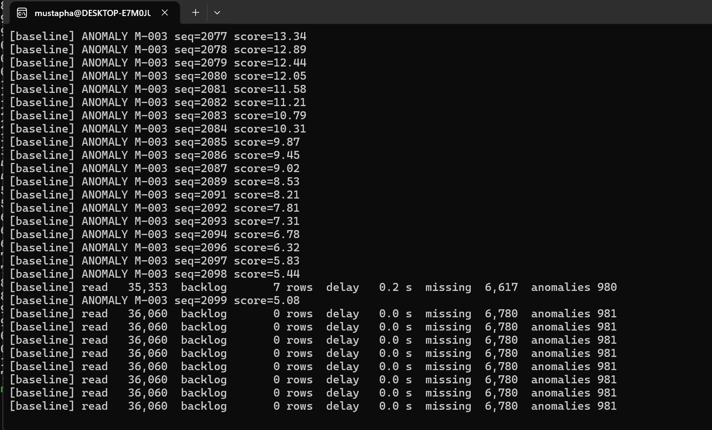
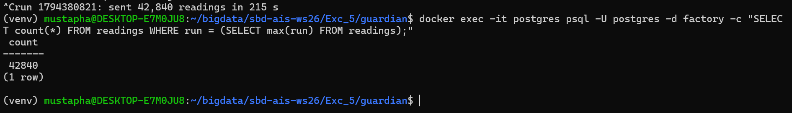
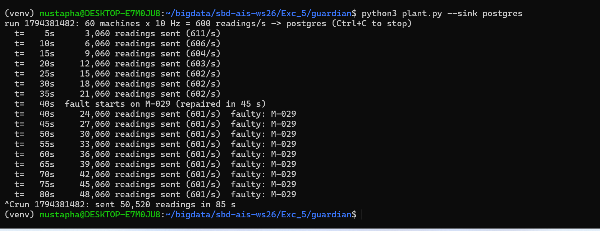
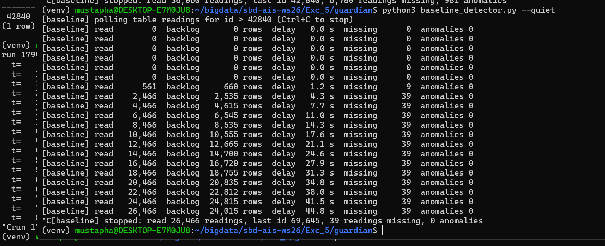
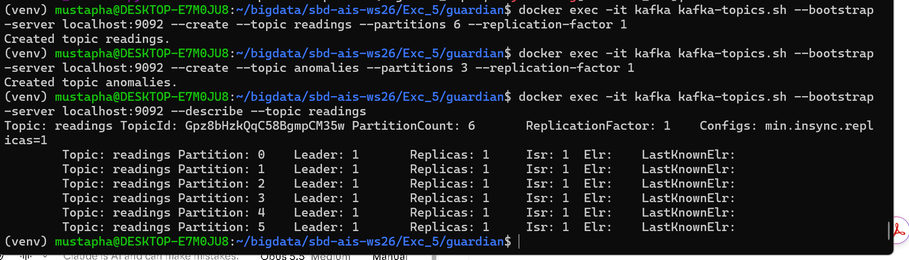
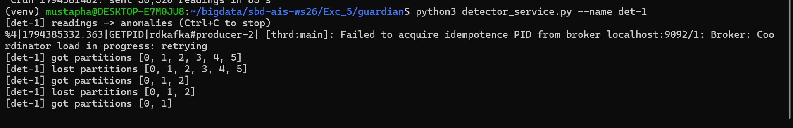
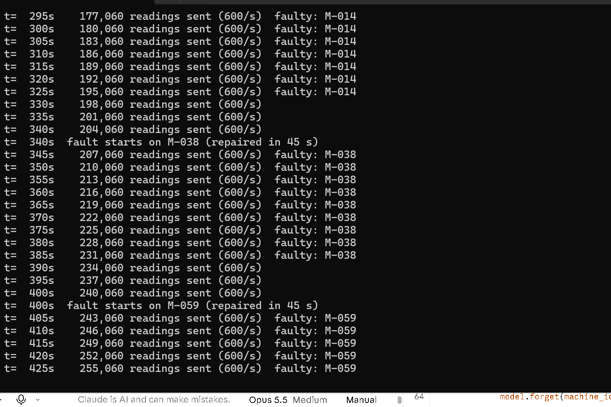
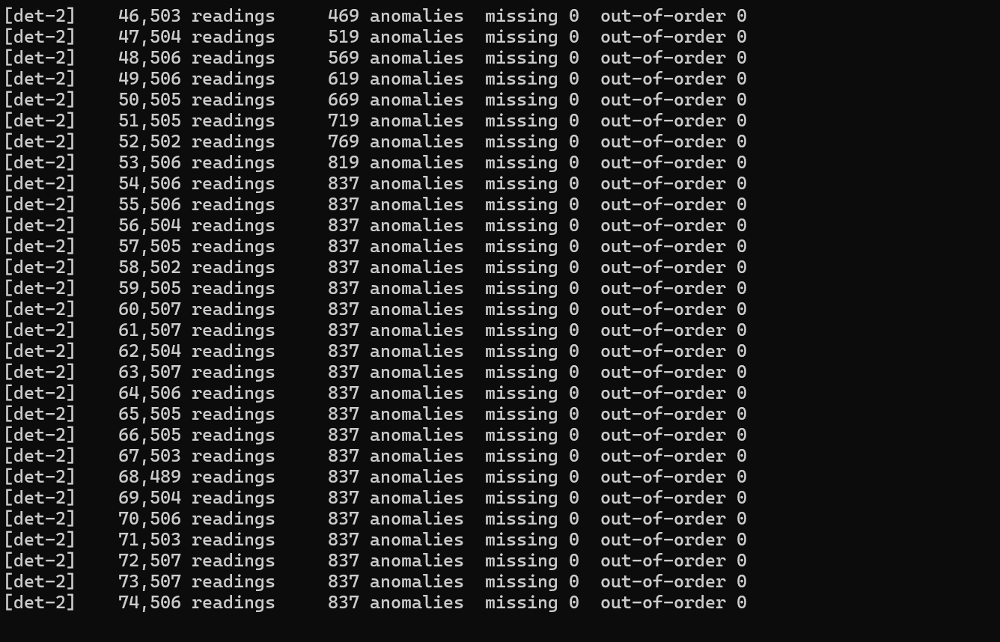
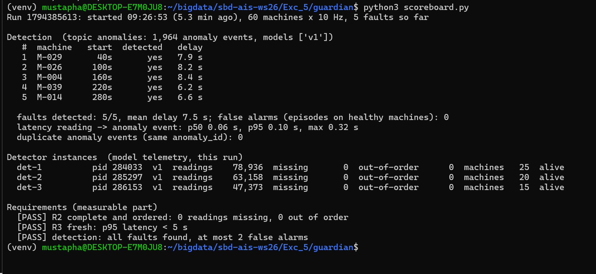

# Exercise 5 – Solution: Line Guardian

Gali Mustapha Oluwatoyin (galimo201516-web)

I ran everything on Windows in Ubuntu 24.04 (WSL2) with Docker Engine. The containers `postgres`, `kafka` and `kafka-ui` were started with `docker compose up -d`, and the Python packages were installed in a virtual environment. My Stage C code is in `../guardian/plant.py` (only the class `KafkaSink`) and `../guardian/detector_service.py`. Screenshots are in the `screenshots` folder.

## Stage A – Today's system

### Run 1: 20 machines (200 readings/s)

I started `baseline_detector.py`, then `plant.py --sink postgres --machines 20`, let it run, stopped the plant, waited until the backlog was 0 and stopped the detector.

| | Value |
|---|---|
| readings in the table for this run | 42,840 |
| readings the detector read | 36,060 |
| `missing` counted by the model | 6,780 |
| backlog / delay at the end | 0 rows / 0.0 s |



The plant's last line ("sent 42,840 readings in 215 s") and the count of the table:



**Are the missing readings in the table?** Yes. 42,840 − 36,060 = 6,780, exactly the `missing` number. So all of them were written to PostgreSQL, the detector just never read them, even though it kept up (backlog 0).

**Why did the detector never see them?** The detector asks for `WHERE id > last_id` and then remembers the highest id it got. But the order of the ids is not the order in which rows become visible:

- A row gets its `id` when it is **inserted** (BIGSERIAL), but other sessions only see it when the transaction **commits**.
- Each of the 4 gateways inserts a batch and then waits 0–120 ms before COMMIT (`PostgresSink` in `plant.py`), so the gateways commit in a random order.

The timeline from the exercise: gateway 1 inserts rows 100–114 and commits 100 ms later; gateway 2 inserts rows 115–129 and commits at once. If the detector polls in between, it sees **only 115–129** (100–114 are not committed yet), and remembers `last_id = 129`. When gateway 1 commits, its rows 100–114 are visible, but they are below 129, so `id > 129` never returns them. They are lost for the detector, even though they are in the table. That is why the model counts them as missing, about 16 % in my run.

### Run 2: the full plant (60 machines, 600 readings/s)

| Time | backlog | delay | missing | anomalies |
|---|---|---|---|---|
| shortly after start | 660 rows | 1.2 s | 9 | 0 |
| ~10 s later | 2,535 rows | 4.3 s | 39 | 0 |
| at the end (~80 s) | 24,815 rows | 44.8 s | 39 | 0 |





**What happens and why:**

- **backlog and delay grow all the time.** The model needs 3 ms per reading, so one detector can do at most about 333 readings/s, but the plant writes 600/s. Every status line the detector reads one batch of 2,000 rows (2,000 × 3 ms = 6 s), while the plant adds more than that. The delay passes the 5 s limit (R3) after about 10 seconds and is 44.8 s at the end.
- **anomalies stay 0.** The fault on M-029 started at t = 40 s, but at the end the detector was about 45 s behind, so it never even reached the readings of the fault. An alert that comes a minute late is useless for the maintenance team.
- **missing stays low (39).** This looks better than run 1, but only because the detector is so far behind: it reads old rows that were committed long ago, so the commit race only matters at the head of the table. As soon as it caught up, it would lose rows again.

So today's system fails twice: it loses readings (R2) even when it keeps up, and it cannot keep up at full rate (R1, R3).

## Stage B – Decision record

**Context.** 60 machines × 10 Hz = 600 readings/s in the lab, 2,000 machines × 50 Hz = 100,000 readings/s after the rollout. The model is stateful per machine and costs 3 ms per reading. Requirements R1–R4 from the exercise. PostgreSQL stays the system of record for the machine registry.

**Option 1: keep PostgreSQL, poll it better** (e.g. several pollers, each for a group of machines, maybe polling by `machine_id` and `seq` instead of `id`).

- R1 scale: at risk. Several pollers help with the model cost, but PostgreSQL must take 100,000 inserts/s *and* all the polling queries on the same table, and the table grows by billions of rows per day.
- R2 complete and ordered: possible if each poller polls per machine by `seq` (a machine's readings come from one gateway, in order), but the `id`-based polling of today loses rows (Stage A). Easy to get wrong.
- R3 fresh: OK at small scale; at full scale the delay depends on how fast the database answers the polls.
- R4 independent consumers: fails. Every new consumer (archive, dashboard) is one more poller on the same database and adds load to PostgreSQL.

**Option 2: the gateways write every reading to Kafka.**

- R1: a topic is split into partitions, and a consumer group spreads the partitions over many detector instances. More load → more partitions, instances and brokers.
- R2: key = `machine_id` → all readings of one machine go to the same partition, and Kafka keeps the order inside a partition. With `acks=all` and an idempotent producer, retries do not lose, duplicate or reorder readings. Inside one group, a partition belongs to exactly one detector, so one model instance sees every reading of its machines, in `seq` order.
- R3: consumers get new events within milliseconds, without polling a database.
- R4: the archive and the dashboard are just other consumer groups. Each group has its own offsets, so they read the same log without slowing down or changing the detector, and without touching PostgreSQL.

**Decision: option 2 (Kafka).** It meets all four requirements by design. Option 1 can be made correct, but it puts every new reader on the database and it does not grow to 100,000 readings/s.

**Numbers.**

- One detector instance: 1 / 3 ms ≈ **333 readings/s**.
- Lab, 600 readings/s: 600 / 333 = 1.8 → at least **2 instances**; I use **3** for headroom, on a topic with **6 partitions** (2 per instance, and room to grow to 6 instances). In my run the keys were not spread perfectly evenly (one instance got 25 machines = 250 readings/s), which is another reason not to plan at 100 %.
- Rollout, 100,000 readings/s: 100,000 / 333 = 300 instances at 100 %. At about 70 % load per instance that is roughly **430 instances**, so the topic needs at least that many partitions (e.g. 480 or 512), spread over several Kafka brokers.

**Tipping point.** A small office that logs one temperature per minute (0.017 readings/s) is perfectly served by PostgreSQL: one writer, one reader, no rush. PostgreSQL stops being enough when (a) several writers commit at the same time and every single event matters (Stage A run 1 already lost rows at 200 readings/s), (b) one reader cannot keep up any more (here about 333 readings/s per model instance), or (c) several independent consumers need the same stream. Roughly, from a few hundred events per second, or as soon as there is more than one consumer, a log like Kafka is the better tool.

## Stage C – Build the core (optional)

### Topic

I created the topics before the first run, because a topic created by the first write gets only 1 partition:

```bash
docker exec -it kafka kafka-topics.sh --bootstrap-server localhost:9092 --create --topic readings --partitions 6 --replication-factor 1
docker exec -it kafka kafka-topics.sh --bootstrap-server localhost:9092 --create --topic anomalies --partitions 3 --replication-factor 1
```



### KafkaSink (`plant.py`)

```python
self.producer = Producer({
    "bootstrap.servers": args.bootstrap,
    "acks": "all",
    "enable.idempotence": True,
    "linger.ms": 20,
    "partitioner": "murmur2_random",
})

def send(self, reading):
    self.producer.produce(self.topic, key=reading["machine_id"], value=json.dumps(reading))
```

- **Key `machine_id`**: all readings of a machine land in the same partition, in order (R2).
- **`acks=all` + idempotence**: a retry cannot lose, duplicate or reorder a reading.
- **`linger.ms=20`**: the readings of one tick are sent together in batches. There is no `flush()` per reading, which would slow the plant down.

### Detector service (`detector_service.py`)

- **`--in-topic readings`, `--group line-guardian`**: all instances are in **one** group, so Kafka gives each partition, and so each machine, to exactly one instance.
- **`auto.offset.reset = latest`**: a live detector should start with new readings, not with the history of old runs. It only applies when the group has no committed offset yet; after earlier runs the group continues at its committed offset.
- **Anomalies keyed by `machine_id`**: the anomalies of one machine stay in order for the maintenance team.
- **Rebalance**: when a partition is taken away, the model forgets the machines of that partition (`model.forget`). Otherwise, if the partition came back later, the model would continue with old state and count the gap as missing readings.

### Run

I started 3 detectors one after the other (each join caused a rebalance, at the end each had 2 partitions), then `plant.py --sink kafka` with 60 machines at 600 readings/s, and ran `scoreboard.py` after about 5 minutes.









**Scoreboard:**

- faults detected: **5/5**, mean delay 7.5 s, **0 false alarms**
- latency reading → anomaly event: p50 0.06 s, **p95 0.10 s**, max 0.32 s
- duplicate anomaly events: 0
- detectors: det-1 25 machines, det-2 20, det-3 15, all with **0 missing and 0 out-of-order**
- **[PASS] R2** complete and ordered, **[PASS] R3** fresh, **[PASS] detection**

Compared with Stage A: the same model, the same 600 readings/s, but now no reading is lost, and an anomaly reaches the `anomalies` topic in about 0.1 s instead of falling more and more behind. The "mean delay 7.5 s" is the time from the start of a fault until the vibration has risen enough for the model to notice it; the processing itself takes only milliseconds.

Note: det-1 printed one startup message "Failed to acquire idempotence PID … Coordinator load in progress: retrying". That is Kafka still starting its internal coordinator; the producer retried and worked.
