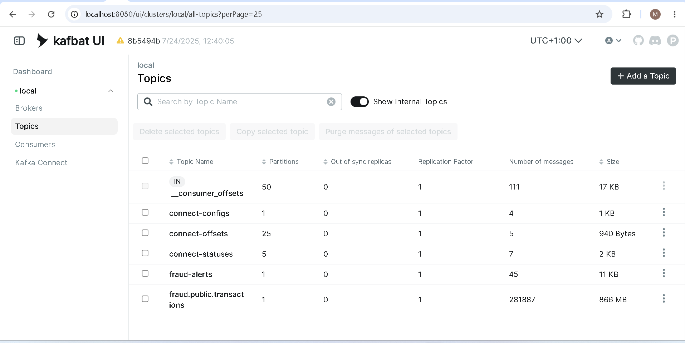
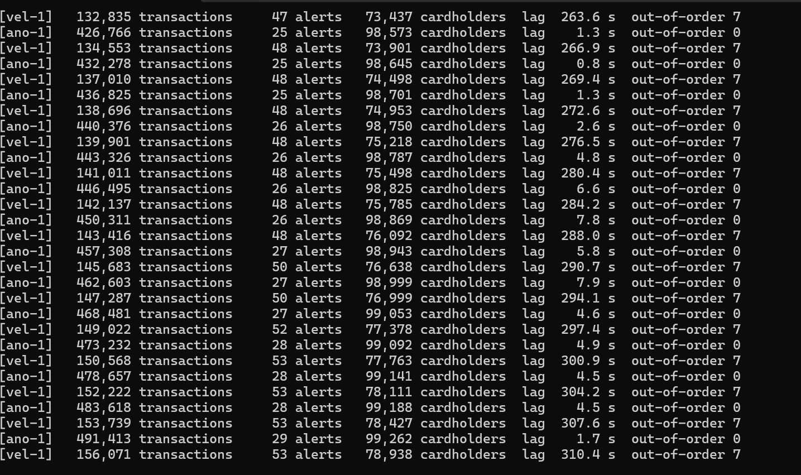
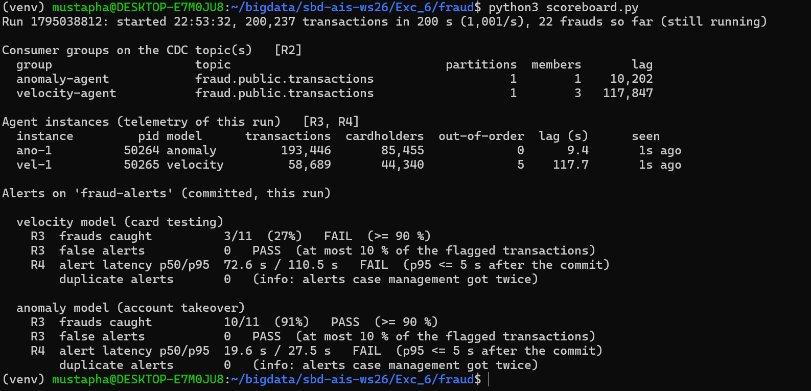
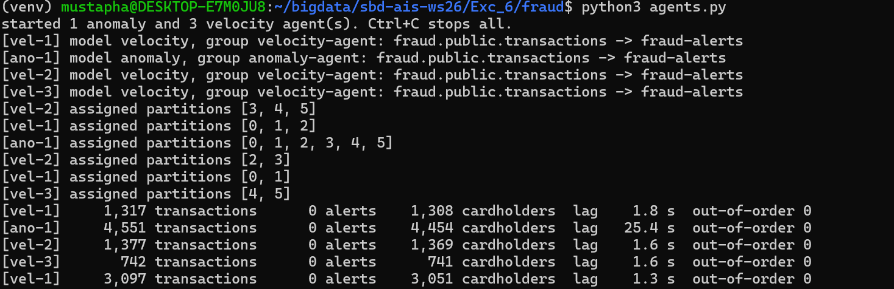
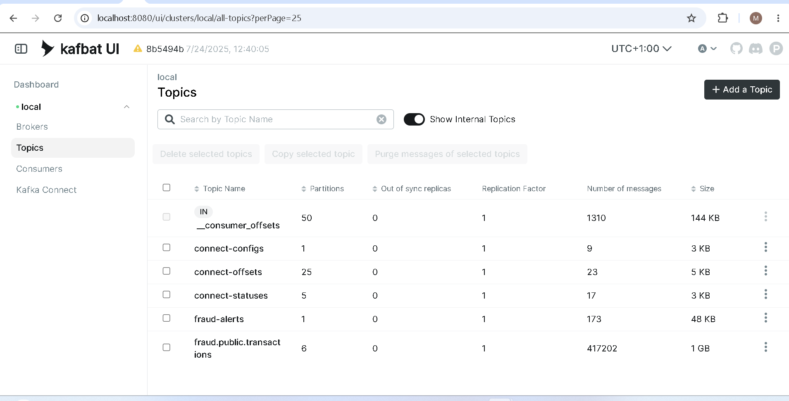
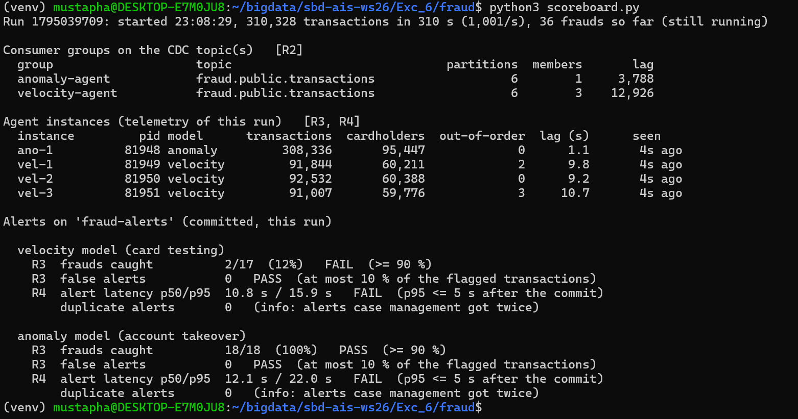
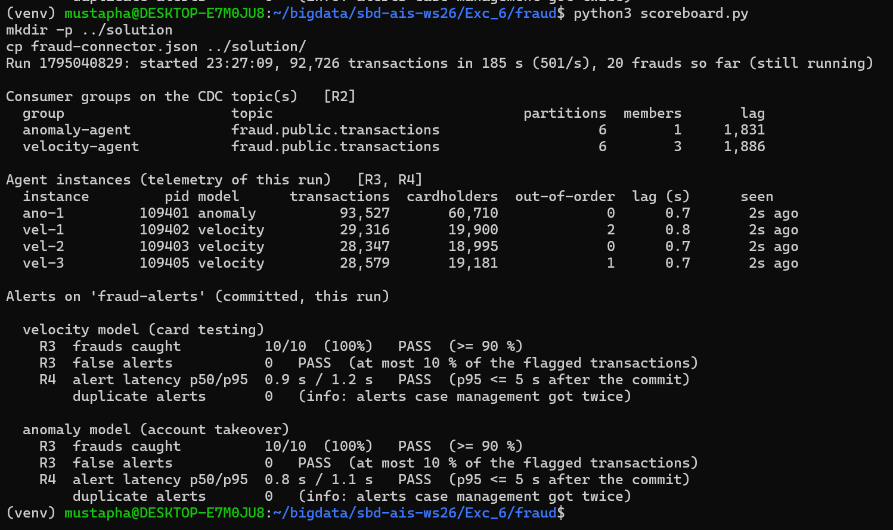
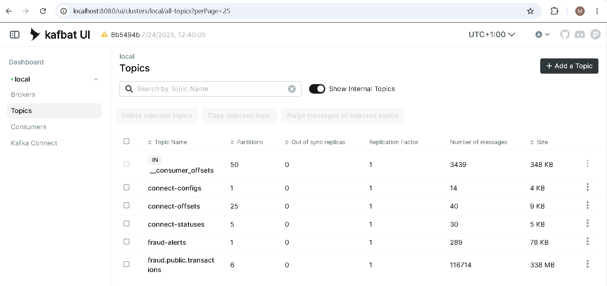

# Exercise 6 – Solution: Card Sentinel

Gali Mustapha Oluwatoyin (galimo201516-web)

I ran everything on Windows in Ubuntu 24.04 (WSL2) with Docker Engine. I stopped the containers of Exercise 5, started this exercise with `docker compose up -d` and used the routine from the exercise for every run (connector.py, card_processor.py, agents.py, wait about 2 minutes, scoreboard.py). My final connector is in `fraud-connector.json`, and the screenshots are in the `screenshots` folder.

## Part 1 – The decision

I choose log-based CDC with Debezium. The payment path belongs to another team and is certified, so dual write and outbox are out, because both change `card_processor.py` (R1). Polling is also out: it puts extra queries on the system of record for every agent, and in Exercise 5 I saw myself that `WHERE id > last_id` misses rows that commit out of id order (R2). CDC reads the write-ahead log, so it needs no code change and no queries, and it sees every committed payment in commit order. The cost is the replication slot: PostgreSQL keeps all WAL that Debezium has not read yet, so if the connector stops for a long time the disk can fill up and the payment database stops too. In production I would monitor the connector status and the size of the WAL the slot holds back (`pg_replication_slots`), alert when it grows, and set a limit like `max_slot_wal_keep_size`. If my team owned the payment path, I would choose the outbox, because then the event is written in the same transaction as the payment and we control its format.

## Run 1 – Debezium's defaults

**Prediction:** only one velocity instance works and R4 fails, because nobody told Debezium how many partitions to create.

```
velocity  R3  frauds caught          3/11  (27%)   FAIL
velocity  R4  alert latency p50/p95  72.6 s / 110.5 s   FAIL
```





**Why:** the topic was created with 1 partition, and inside a consumer group one partition is read by one instance only. The scoreboard shows `members 3` but `partitions 1`, and only vel-1 reports; vel-2 and vel-3 sat idle. One instance manages about 500 payments/s of the 1,000, so its lag grew all the time (over 300 s in my run), and most frauds were still waiting in the backlog, so R3 failed as well.

## Run 2 – 6 partitions

**Prediction:** all three instances work and R4 gets much better, but R3 fails, because the key is still the payment id.

```
velocity  R3  frauds caught          2/17  (12%)   FAIL
velocity  R4  alert latency p50/p95  10.8 s / 15.9 s   FAIL
```





**Why:** each instance got two partitions ([0, 1], [2, 3], [4, 5]) and they shared the work evenly. But the key was `{"id": ...}`, so the partition is a hash of the payment id, and the 12 test payments of one stolen card were spread over all partitions. Each instance saw only about 4 of them in its 60 s window, below the threshold of 8, so nobody raised the alert. The anomaly model still caught 18/18 because one instance reads all 6 partitions. R4 also failed here, but the lag was about 10 s on all instances, so I think my laptop was too slow for 1,000 payments/s with everything running on it.

## Run 3 – the cardholder as the key

**Prediction:** the key becomes `{"user_id": ...}`, all payments of a cardholder go to the same instance, and the velocity model catches its frauds.

Because my laptop could not keep up at 1,000/s in Run 2, I ran the card processor with `--tps 500`, as the exercise suggests.

```
velocity  R3  frauds caught          10/10  (100%)   PASS
velocity  R3  false alerts           0   PASS
velocity  R4  alert latency p50/p95  0.9 s / 1.2 s   PASS
```




**Why:** with `message.key.columns` set to `user_id`, the partition depends on the cardholder, so all payments of one cardholder land in the same partition and are read by the same instance, in commit order. That instance counts all 12 test payments and alerts at the 8th. All instances kept up (lag below 1 s), and the anomaly model passed too (10/10, p95 1.1 s). One limit of my result: Run 3 was at 500 payments/s, not the full 1,000/s.

## Closing answer

Debezium chose 1 partition and the table's primary key as the event key. Both are fine for copying a table, but wrong for a stateful model that has to scale. In production, the team would have started more velocity instances and nothing would have changed, because the extra ones stay idle while the lag grows. After adding partitions, the model would have silently caught almost no card-testing frauds, because no instance sees all payments of a cardholder. Nothing crashed in either case and there was no error message, so the only sign is in the numbers. The team could have noticed it by watching consumer lag and the partitions per group member, by checking the key of an event in the Kafka UI, and by measuring the caught frauds against confirmed cases (chargebacks) the way the scoreboard does here.
