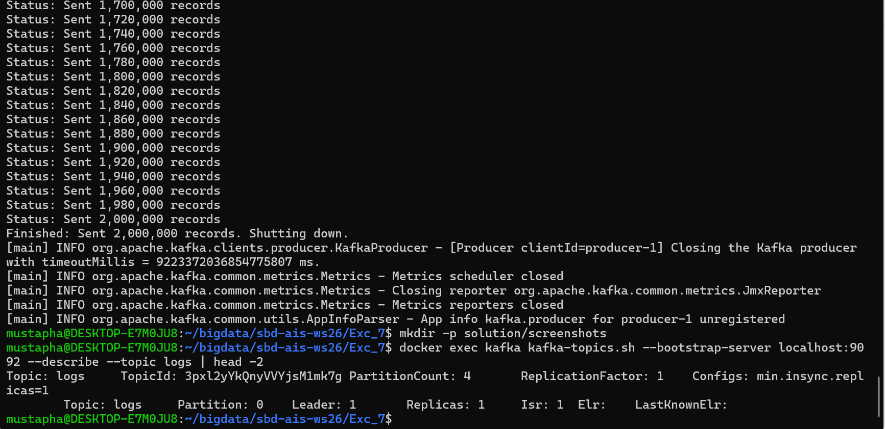
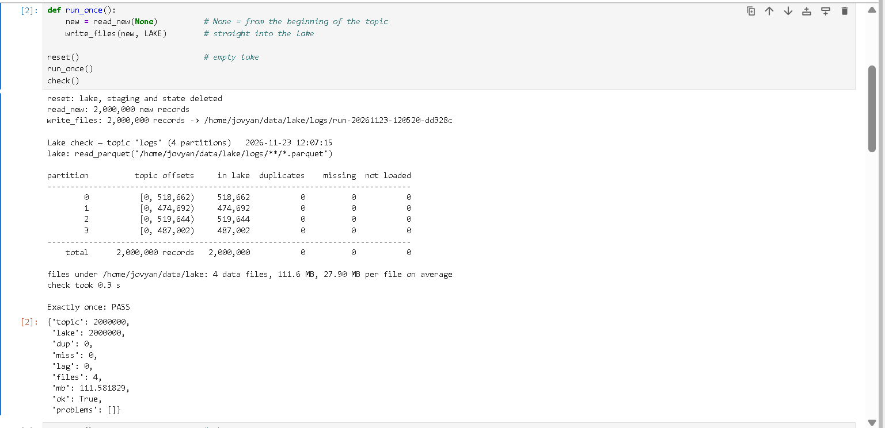
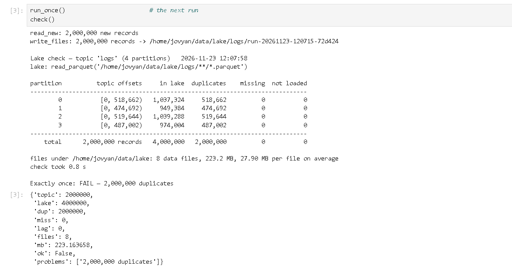
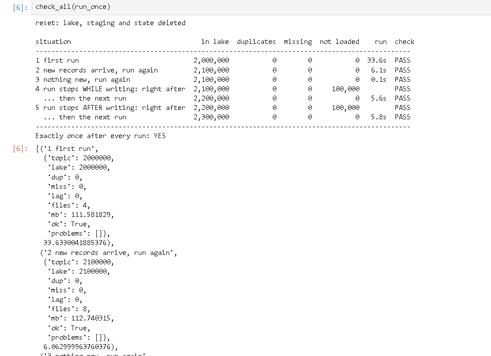
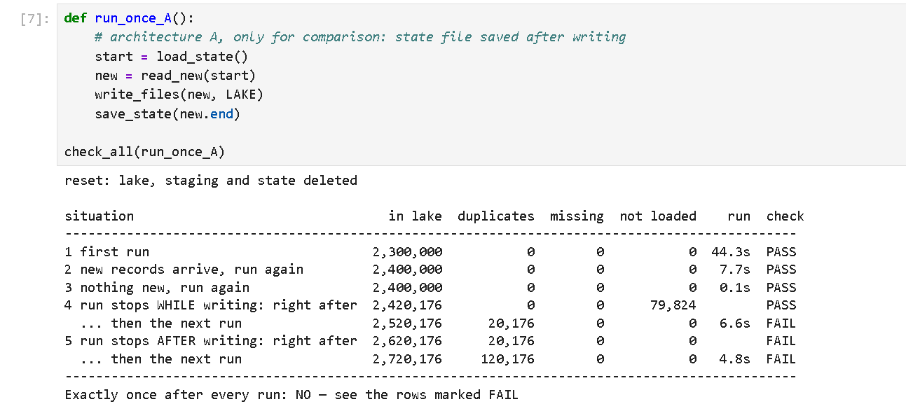

# Exercise 7 – Solution: From the log to the lake

Gali Mustapha Oluwatoyin (galimo201516-web)

I ran everything on Windows in Ubuntu 24.04 (WSL2) with Docker Engine. I stopped the containers of Exercise 6, started this exercise with `docker compose up -d`, created the topic `logs` with 4 partitions and filled it with the generator (2,000,000 records). Then I worked in the notebook in Jupyter. My notebook is `exercise7.ipynb` in this folder, and the screenshots are in `screenshots`.



## The example: why the checker fails

The example job reads the topic from the beginning every time (`read_new(None)`) and writes straight into the lake. After the first run the check passes: 2,000,000 records, each once.



After the second run the lake has 4,000,000 records and the check fails with **2,000,000 duplicates**. The job does not remember where it stopped, so every run copies the whole topic again.



## 1. My decision: architecture B, the lake is the truth

```python
def run_once():
    # 1. where did the last run stop? (read from the lake itself)
    start = lake_position()
    # 2. read what is new
    new = read_new(start)
    # 3. write it: first into STAGING, then into the lake in one step
    run = write_files(new, STAGING)
    publish(run)
    # 4. remember where you stopped (if your architecture needs it)
    # not needed: the lake itself is the state
```

I chose B because the position and the data can never disagree. There is only one place that says what has been loaded, and that is the lake itself (`MAX(kafka_offset) + 1` per partition). The data goes into the lake with one rename, so a reader sees either the whole run or nothing of it.

The other two options have weaknesses:

- **A (state file)** keeps the position in a second place. Writing the data and saving the state are two separate steps, so a stop between them leaves the two out of sync. I tested this (see below), and it gave duplicates.
- **C (remove duplicates when reading)** keeps the duplicates in the lake. Every reader has to use the dedup view, and a reader who forgets it gets wrong numbers. The lake also keeps growing with copies, and every query pays for the deduplication.

B also has costs. `lake_position()` has to scan the offset columns of the lake at the start of every run, which gets slower as the lake grows; in a real system I would use a table format like Delta Lake or Iceberg, which keeps this kind of metadata. B also relies on the rename being a single step, which is true on a local file system but not on every object store (for example, a "rename" on S3 is a copy and a delete). And it only works because every record keeps its `kafka_partition` and `kafka_offset`.

## 2. My result

`check_all(run_once)` passed all five situations:



- **Runs 1 to 3:** the job loads 2,000,000 records, then only the 100,000 new ones, then nothing (0.1 s), because it starts where the lake ends.
- **Stop while writing:** one partition was already written, but only into STAGING. Readers did not see it: right after the stop the lake still had 2,100,000 records, 0 duplicates, and 100,000 not loaded yet. The next run cleaned STAGING, read again from the lake's position and loaded the 100,000 once.
- **Stop after writing:** all files were written, but `publish` never ran, so the lake was unchanged again. The next run did the same thing as above.

So a stop only ever leaves work for the next run, never a half-loaded or doubled lake.

**Comparison with A.** To check my reasoning, I also ran `check_all` with architecture A (`load_state`, `write_files` straight into the lake, then `save_state`):



A fails in both stop situations. When it stopped while writing, one partition (20,176 records) was already in the lake but the state file was not updated, so the next run wrote these records again: 20,176 duplicates. When it stopped after writing, all 100,000 records were in the lake but the state still pointed to the old position, so the next run copied them again: 120,176 duplicates in total. A could be made better by writing to STAGING first, but the gap between the publish and `save_state` would still be there.

## 3. Output of `check_all(run_once)`

```
situation                                 in lake  duplicates  missing  not loaded     run  check
-----------------------------------------------------------------------------------------------
1 first run                             2,000,000           0        0           0   33.6s  PASS
2 new records arrive, run again         2,100,000           0        0           0    6.1s  PASS
3 nothing new, run again                2,100,000           0        0           0    0.1s  PASS
4 run stops WHILE writing: right after  2,100,000           0        0     100,000          PASS
  ... then the next run                 2,200,000           0        0           0    5.6s  PASS
5 run stops AFTER writing: right after  2,200,000           0        0     100,000          PASS
  ... then the next run                 2,300,000           0        0           0    5.8s  PASS
-----------------------------------------------------------------------------------------------
Exactly once after every run: YES
```
